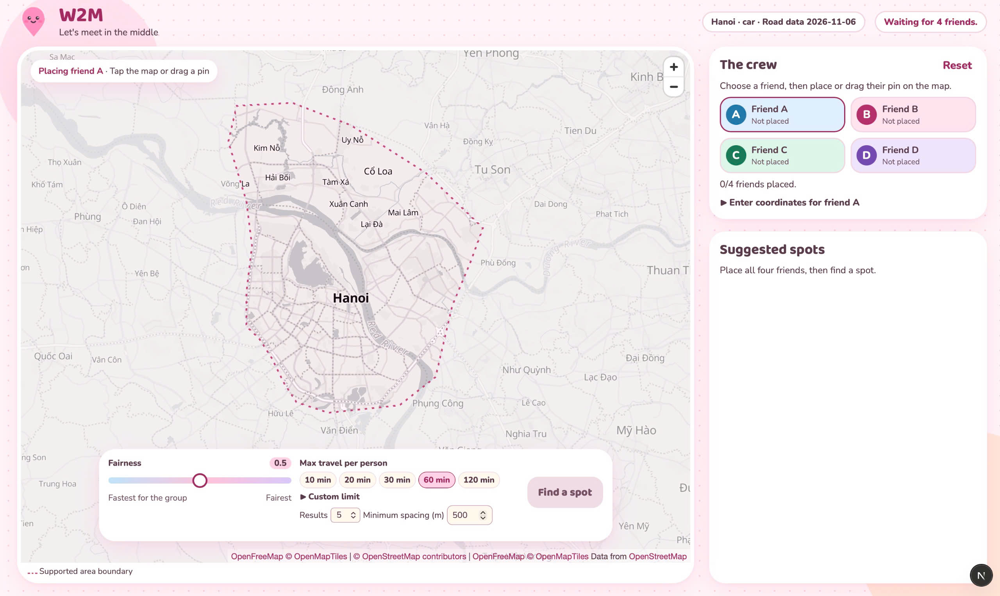
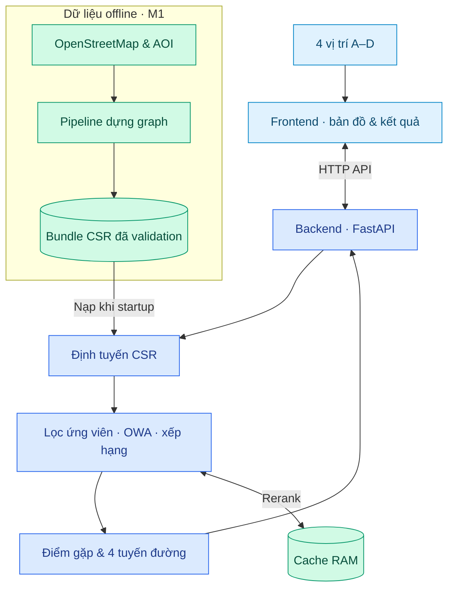
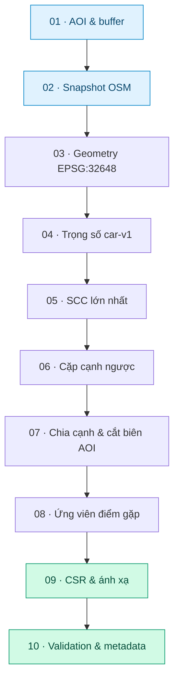

<div align="center">

# W2M

### WHERE TO MEET

**Bốn người. Một điểm gặp. Cân bằng thời gian di chuyển.**

Ứng dụng tìm điểm gặp cho 4 người trên mạng đường có hướng tại Hà Nội,<br>
dựa trên thời gian di chuyển và mức ưu tiên công bằng của cả nhóm.


[Giao diện](#giao-diện-ứng-dụng) · [Chạy ngay](#chạy-local-bằng-docker-compose) · [Kiến trúc](#kiến-trúc-hệ-thống) · [API](#api-local) · [Kiểm thử](#kiểm-thử) · [Kế hoạch MVP](docs/plans/W2M-MVP-Plan.md)

</div>

---

## Giao diện ứng dụng

<div align="center">
  
  <br>
  <sub>W2M — Bản đồ phạm vi hỗ trợ tại Hà Nội, bảng chọn bốn người và các tùy chọn tìm điểm gặp.</sub>
</div>

## Tổng quan

**W2M (Where to meet)** không chỉ tìm một vị trí trên bản đồ: hệ thống tìm điểm gặp dựa trên thời gian đi theo mạng đường và mức ưu tiên công bằng giữa bốn người.

Backend đã hỗ trợ định tuyến CSR, tìm điểm gặp và rerank trên bundle Vành đai 3. Frontend hiển thị bản đồ và phạm vi hỗ trợ từ backend. Xem tiến độ triển khai tại [kế hoạch MVP](docs/plans/W2M-MVP-Plan.md).

| Khả năng | Mô tả |
| :--- | :--- |
| **Điểm gặp cho nhóm** | Đặt bốn vị trí A–D trong AOI và nhận danh sách điểm gặp theo thứ hạng. |
| **Định tuyến có hướng** | Tính thời gian di chuyển trên đồ thị đường bộ với profile ô tô `car-v1`. |
| **Cân bằng thời gian** | Xếp hạng điểm gặp bằng OWA theo mức ưu tiên công bằng của nhóm. |
| **Rerank từ cache** | Xếp hạng lại từ bảng đã tính; yêu cầu tính mới khi cache không còn phù hợp. |
| **Trực quan hóa bản đồ** | Hiển thị phạm vi hỗ trợ, vị trí người dùng và bốn tuyến đường tới điểm gặp. |
| **Dữ liệu offline có phiên bản** | Nạp bundle CSR đã validation, kiểm tra metadata và checksum khi startup. |

### Kết quả kiểm tra nổi bật

| Backend | Frontend | TC-15 | TC-16 | Benchmark M6 |
| :---: | :---: | :---: | :---: | :---: |
| **471** | **29** | **200/200** | **1.000/1.000** | **10/10** |
| test đạt | test đạt | cặp đạt | request đạt | điều kiện đạt |

<sub>Số liệu từ hồ sơ kiểm tra local M6 ngày 25/11/2026, không phải trạng thái CI trực tiếp. Xem <a href="#hồ-sơ-kiểm-tra-m6">bằng chứng và cách tái lập</a>.</sub>

## Kiến trúc hệ thống



| Thành phần | Công nghệ / dữ liệu |
| :--- | :--- |
| Frontend | TypeScript, Node.js 22, MapLibre style / raster tiles |
| Backend | Python 3.12, FastAPI, Uvicorn, CSR |
| Dữ liệu không gian | OpenStreetMap, OSMnx, GeoPandas, GeoJSON, GraphML |
| Mô hình tối ưu | Mạng đường có hướng, profile `car-v1`, OWA |
| Vận hành và kiểm thử | Docker Compose v2, uv, Ruff, pytest, Playwright |

<details>
<summary><strong>Mục lục đầy đủ</strong></summary>

- [Giao diện ứng dụng](#giao-diện-ứng-dụng)
- [Chạy local bằng Docker Compose](#chạy-local-bằng-docker-compose)
  - [Thay đồ thị và xử lý lỗi](#thay-đồ-thị-và-xử-lý-lỗi)
- [Yêu cầu và cài đặt](#yêu-cầu-và-cài-đặt)
- [Chạy development](#chạy-development)
  - [Bản đồ nền local](#bản-đồ-nền-local)
  - [API local](#api-local)
- [Kiểm thử](#kiểm-thử)
  - [E2E M5 với bundle Vành đai 3](#e2e-m5-với-bundle-vành-đai-3)
- [Pipeline dữ liệu offline — M1](#pipeline-dữ-liệu-offline--m1)
- [Kiểm tra prototype tham chiếu M2](#kiểm-tra-prototype-tham-chiếu-m2)
- [Đối chiếu TC-16](#đối-chiếu-tc-16)
- [Benchmark API trên Docker (M6)](#benchmark-api-trên-docker-m6)
- [Hồ sơ kiểm tra M6](#hồ-sơ-kiểm-tra-m6)
- [Giới hạn mô hình](#giới-hạn-mô-hình)
- [Cấu trúc mã nguồn](#cấu-trúc-mã-nguồn)

</details>

---

## Chạy local bằng Docker Compose

> [!IMPORTANT]
> Cần Docker có Compose v2 và thư mục `validated` của bundle Vành đai 3
> `hanoi-ring3-car-v1-3000-v1`.

Compose dùng bundle trong
`backend/data/builds/hanoi-ring3-car-v1-3000-v1/validated` mặc định. Nếu bundle
nằm ở nơi khác, đặt `W2M_GRAPH_BUNDLE` thành đường dẫn tới thư mục đó. Chuẩn bị
bundle theo [pipeline offline](#pipeline-dữ-liệu-offline--m1) trước khi chạy.

```sh
docker compose up --build --detach --wait
curl --fail http://localhost:8000/ready
docker compose ps
```

**Bắt đầu sử dụng**

1. Mở [http://localhost:3000](http://localhost:3000).
2. Đặt bốn vị trí A–D trong AOI và bấm **Find a spot**.
3. Chọn một điểm gặp để xem bốn tuyến A–D.

| Dịch vụ | Địa chỉ local |
| :--- | :--- |
| Frontend | [localhost:3000](http://localhost:3000) |
| Backend readiness | [localhost:8000/ready](http://localhost:8000/ready) |
| Swagger / OpenAPI | [localhost:8000/docs](http://localhost:8000/docs) |

Hai cổng chỉ mở trên máy local.
Nếu cổng đã được dùng, chạy lệnh khởi động với
`W2M_FRONTEND_PORT=3001 W2M_BACKEND_PORT=8001` ở trước lệnh và dùng các cổng
tương ứng trong trình duyệt. Compose ghép URL API và CORS từ hai cổng này.

Backend kiểm tra metadata và checksum khi nạp bundle được mount chỉ đọc.
Frontend khởi động sau khi `/ready` trả 200. Nếu quá trình chờ lỗi, chạy
`docker compose logs backend` để xem trạng thái nạp graph. Dùng
`docker compose down` để dừng hai dịch vụ.

### Thay đồ thị và xử lý lỗi

Tạo bundle theo [hướng dẫn dựng lại snapshot và graph Vành đai 3](backend/data/README.md#aoi-vành-đai-3-và-nghiệm-thu-m1).
Giữ cả thư mục `validated` của từng phiên bản để có thể quay lại bundle trước.
Chọn bundle bằng đường dẫn tuyệt đối của thư mục đó rồi tạo lại backend.

```sh
W2M_GRAPH_BUNDLE=/absolute/path/to/new/validated docker compose up --detach --wait --force-recreate backend
curl --fail http://localhost:8000/ready
curl --fail http://localhost:8000/api/v1/map/config
```

`/api/v1/map/config` cho biết `graph_version` và `weight_profile_version` đang chạy.
Để quay lại, chạy cùng lệnh với đường dẫn bundle trước. Restart làm mất cache trong RAM,
nên ứng dụng có thể nhận 409 và tính lại từ bốn vị trí hiện tại.

| Triệu chứng | Cách kiểm tra hoặc xử lý |
|---|---|
| Compose báo thiếu bind mount | Kiểm tra `W2M_GRAPH_BUNDLE` trỏ tới thư mục `validated` có thật trên host. |
| `/health` trả 200 nhưng `/ready` trả 503 | Kiểm tra log startup, quyền đọc và bộ file đi cùng `metadata.json`. Nếu checksum sai, dùng lại toàn bộ bundle đã validation hoặc dựng bundle mới. |
| Trình duyệt báo lỗi mạng hoặc CORS | Kiểm tra cổng backend/frontend, `/ready` và `NEXT_PUBLIC_API_BASE_URL`. Build lại frontend nếu đổi URL backend. |
| `SNAP_FAILED` | Kiểm tra điểm nằm trong AOI và dời gần một đường thuộc mạng ô tô. Một số đường bị loại khi giữ SCC lớn nhất. |
| `NO_COMMON_REACHABLE_NODE` | Tăng cutoff trong giới hạn API hoặc đổi vị trí. |
| `RECOMPUTE_REQUIRED` | Tính mới khi dữ liệu cache hết hạn, bị loại hoặc không phủ cutoff mới. |

Bản đồ nền mặc định dùng OpenFreeMap Positron. Để đổi nguồn tile cho Docker,
đặt các biến `NEXT_PUBLIC_MAP_*` trong môi trường shell hoặc `.env` ở thư mục gốc,
rồi chạy lại `docker compose up --build --detach --wait`. Với tile raster, đặt
`NEXT_PUBLIC_MAP_STYLE_URL=` và điền URL tile cùng ghi công nhà cung cấp theo
[tài liệu nguồn tile](docs/plans/W2M-M6-Tile-Provider.md).

---

## Yêu cầu và cài đặt

Cần Python 3.12, uv và Node.js 22/npm. Chạy các lệnh dưới đây từ thư mục gốc repo
để `.env` và đường dẫn dữ liệu được đọc đúng.

Chỉ sao chép file môi trường khi chưa có; giữ nguyên cấu hình đang sử dụng:

```sh
cp .env.example .env
cp frontend/.env.example frontend/.env.local
```

Cài dependency từ hai lockfile đã có trong repo:

```sh
uv python install 3.12
uv sync --project backend --locked --extra data
npm --prefix frontend ci
```

Extra `data` cung cấp OSMnx/GeoPandas cho các CLI offline và test roundtrip GraphML.
Nếu chỉ chạy API nền tảng, có thể bỏ `--extra data`; khi không có OSMnx, các test
roundtrip tương ứng sẽ bị bỏ qua. Không cần sinh lại lockfile khi cài đặt thông thường.

---

## Chạy development

**Terminal 1 — Backend**

```sh
mkdir -p backend/data/logs
W2M_GRAPH_DIR=backend/data/builds/hanoi-ring3-car-v1-3000-v1/validated \
  uv run --project backend --locked uvicorn app.main:app --app-dir backend --reload --port 8000 \
  --no-access-log 2>&1 | tee -a backend/data/logs/backend-dev.log
```

Log vẫn hiện trong terminal và được ghi nối tiếp vào `backend/data/logs/backend-dev.log`
qua các lần chạy. Thư mục `backend/data/` được Git bỏ qua. Xem riêng log kết quả tìm điểm gặp bằng:

```sh
rg 'meeting_result' backend/data/logs/backend-dev.log
```

**Terminal 2 — Frontend**

```sh
npm --prefix frontend run dev
```

- Frontend: `http://localhost:3000`.
- Swagger/OpenAPI: `http://localhost:8000/docs`.

Trang chính tải AOI từ `GET /api/v1/map/config` và căn bản đồ theo phạm vi này.
Nếu graph chưa sẵn sàng, bấm **Try again** sau khi `GET /ready` trả 200.
Đặt đủ bốn vị trí A–D rồi bấm **Find a spot** để xem danh sách theo thứ hạng từ backend.

### Bản đồ nền local

Mẫu cấu hình dùng raster **CARTO Positron**. Điền URL tile và ghi công nhà cung
cấp trong `frontend/.env.local` theo `frontend/.env.example`. Nếu có
`NEXT_PUBLIC_MAP_STYLE_URL`, ứng dụng ưu tiên style MapLibre JSON đó. Khởi động
lại dev server hoặc build lại bản production sau khi đổi biến môi trường.

Bản đồ luôn ghi công OpenStreetMap. Khi thiếu cấu hình tile, ứng dụng thông báo
và hiển thị các lớp AOI, vị trí và tuyến trên nền trống. Xem nguồn tile, yêu cầu
API key, giấy phép và xử lý sự cố trong [tài liệu vận hành M6](docs/plans/W2M-M6-Tile-Provider.md).

### API local

| Endpoint | Hành vi hiện tại |
|---|---|
| `GET /health` | 200 khi process chạy |
| `GET /ready` | 200 khi nạp được CSR, 503 `GRAPH_UNAVAILABLE` nếu bundle thiếu hoặc không hợp lệ |
| `GET /api/v1/map/config` | Trả AOI GeoJSON, phiên bản bundle và tham số runtime |
| `POST /api/v1/meeting-points` | Tính điểm gặp và tuyến bằng CSR |
| `POST /api/v1/meeting-points/{request_id}/rerank` | Xếp hạng từ bảng đã cache, trả 409 `RECOMPUTE_REQUIRED` nếu cần tính lại |

Đặt `W2M_GRAPH_DIR` trong `.env` trỏ đến thư mục đầu ra `validated` của bundle
đồ thị offline. Backend nạp CSR ở startup. `W2M_CSR_MAX_CONCURRENT_TASKS` giới hạn
số tác vụ tính toán CSR chạy cùng lúc trên mỗi process backend, mặc định là 2.
Service CSR đo từng bước theo mili giây. `scan` gồm lọc và tính điểm OWA.
`rank` gồm sắp xếp và chọn điểm theo khoảng cách. `total` đo từ khi tác vụ
bắt đầu chạy đến khi dựng xong kết quả, bao gồm cả bước tạo overlay.
Các endpoint nghiệp vụ trả 503 `GRAPH_UNAVAILABLE` khi chưa nạp được đồ thị. Lỗi validation trả 400
`INVALID_COORDINATES` hoặc `INVALID_PARAMETERS`.

Khi truy lỗi, lấy `X-Request-ID` từ HTTP rồi tìm ID đó trong `docker compose logs backend`.
Bản ghi gồm mẫu route, status, phiên bản graph/profile, `server_ms` tính đến khi backend
tạo phản hồi, và `timings_ms` nếu có kết quả tính toán. Log chuẩn dùng mẫu route cố định,
bỏ URL thô, query, header, body, ID cache rerank và nội dung ngoại lệ. Luồng chạy Docker
và development tắt access log mặc định của Uvicorn.

Sau mỗi lần tìm điểm gặp hoặc xếp hạng lại, trường `meeting_result` ghi trạng thái,
tham số tối ưu thực tế, trọng số OWA và các điểm đã trả theo thứ hạng. Mỗi điểm có
điểm OWA, thống kê thời gian và thời gian tiếp cận, trên đường và tổng của từng tuyến.
Hai mảng `travel_times_seconds` và `routes` cùng theo thứ tự vị trí trong request.
Khi kết quả rỗng, log có `results: []` và `min_required_seconds`.
Log chỉ dùng số liệu tính toán đã trả về API và không chứa tọa độ, ID node, ID nguồn
hay hình học tuyến. Có thể dùng log để tính lại điểm OWA từ trọng số và thời gian đã
ghi, đối chiếu tổng thời gian của tuyến và kiểm tra ngưỡng thời gian theo độ chính xác API.
Để tái hiện đường đi, dùng một bộ tọa độ thử nghiệm biết trước với đúng phiên bản đồ thị.
Khi chạy trực tiếp theo lệnh development, xem bản ghi trong `backend/data/logs/backend-dev.log`.
Khi chạy bằng Docker, dùng `docker compose logs -f --timestamps backend`.

Kiểm tra log khi chạy Docker bằng một request mẫu với cache ID không tồn tại.
Phản hồi trả 409. Trong log, `request_id` khớp `X-Request-ID` và route hiện
`/api/v1/meeting-points/{request_id}/rerank`. Chuỗi `m6-test-marker` chỉ có
trong lệnh mẫu.

```sh
curl -si -X POST 'http://localhost:8000/api/v1/meeting-points/m6-test-marker/rerank?token=m6-test-marker' \
  -H 'Content-Type: application/json' -d '{"optimization":{}}'
docker compose logs --since=2m backend
```

Có thể kiểm tra HTTP bằng:

```sh
curl -i http://localhost:8000/health
curl -i http://localhost:8000/ready
curl -i http://localhost:8000/api/v1/map/config
```

---

## Kiểm thử

```sh
uv run --project backend --locked --extra data ruff check backend
uv run --project backend --locked --extra data pytest backend/tests
npm --prefix frontend run lint
npm --prefix frontend run typecheck
npm --prefix frontend run build
node --test frontend/tests/***.test.mjs
```

Test backend dùng fixture cố định và OSMnx giả lập cho bước tải; không gọi OSM hoặc
ETA service. Các test roundtrip dùng OSMnx thật để lưu/nạp graph tổng hợp local.
CI tại `.github/workflows/ci.yml` chạy backend Ruff/pytest và frontend
lint/typecheck/build; hiện chưa cài extra `data`, nên không kiểm tra toàn bộ roundtrip.

### E2E M5 với bundle Vành đai 3

Khởi động backend và frontend bằng Compose hoặc theo mục **Chạy development**,
rồi chạy các lệnh sau. Nếu dùng cổng frontend khác, đặt
`W2M_E2E_FRONTEND_URL` thành URL frontend thực tế.
Chromium chỉ cần cài một lần. Bộ E2E dùng graph thật, chặn tile ngoài và mô phỏng
lỗi mạng cùng phản hồi đến muộn.

```sh
npm --prefix frontend exec -- playwright install chromium --only-shell
npm --prefix frontend run test:e2e
```

Xem [hồ sơ kiểm tra M6](#hồ-sơ-kiểm-tra-m6) để lưu báo cáo của lần chạy hiện tại.

---

## Pipeline dữ liệu offline — M1



<details>
<summary><strong>Chi tiết tên CLI và đầu ra của từng bước</strong></summary>

```text
Polygon AOI nguồn
  → prepare_aoi           → AOI và routing area có buffer
  → download_osm         → snapshot GraphML thô
  → prepare_graph_geometry → geometry EPSG:32648, chiều dài mét
  → prepare_graph_weights  → tốc độ và thời gian cạnh car-v1
  → prepare_graph_scc       → SCC lớn nhất, GeoJSON phần bị loại
  → prepare_reverse_edges   → ánh xạ cặp cạnh ngược và báo cáo
  → prepare_graph_split     → cạnh ≤ 60 giây, cắt biên AOI, lineage và mapping mới
  → prepare_graph_candidates → cờ phạm vi AOI và điều kiện làm điểm gặp
  → prepare_graph_csr        → CSR, ánh xạ node/cung và geometry có phiên bản
  → validate_graph           → báo cáo validation và metadata đầy đủ
```

</details>

Mỗi CLI chạy riêng; các bước truyền dữ liệu qua file, không tự gọi bước kế tiếp.
Chỉ `download_osm` tải OSM qua mạng. API và startup không gọi các CLI này.

### Artifact local đã kiểm tra

| Bước | Thư mục trong `backend/data/` | Kết quả |
|---|---|---|
| Snapshot | `osm/drive-20261106T092834Z/` | 21.129 node, 36.912 cạnh |
| Hình học | `geometry/drive-20261106T092834Z-utm-v1/` | Giữ topology, geometry theo chiều cạnh, chiều dài mét |
| Trọng số | `weighted/drive-20261106T092834Z-car-v1/` | 40 cạnh dùng default, 44 cạnh bị maxspeed giới hạn |
| SCC | `scc/drive-20261106T092834Z-car-v1-scc-v2/` | Giữ 20.162 node, 35.466 cạnh; loại 967 node, 1.446 cạnh |
| Cạnh ngược | `reverse-edges/drive-20261106T092834Z-car-v1-reverse-v1/` | 13.803 cặp; 7.860 cạnh one-way không ghép; không mơ hồ |
| Chia cạnh | `split/drive-20261106T092834Z-car-v1-split-v1/` | 20.221 node, 35.556 cạnh; max 56,178 giây |
| Gắn cờ ứng viên | `candidates/drive-20261106T092834Z-car-v1-candidates-v1/` | 2.504 ứng viên, gồm 50 node trên biên AOI |
| CSR | `csr/hanoi-pilot-car-v1-csr-v1/` | 20.221 node, 35.556 cung; đối chiếu NetworkX từ 20 nguồn đạt |

> [!NOTE]
> Artifact lớn được Git ignore; chúng không có sẵn chỉ nhờ clone repo. Nếu đã có
> snapshot local ở trên thì tái sử dụng, không cần tải OSM lại.

Snapshot có cutoff
`2026-11-06T09:28:34Z`; các bước sau lưu checksum và metadata để truy vết.

AOI `hanoi-pilot-v1` là hình chữ nhật WGS84 `[105.84, 21.02, 105.86, 21.04]`,
khoảng 4,60 km²; routing area sau buffer 3.000 m khoảng 58,62 km². Đây là vùng
kỹ thuật thử nghiệm, chưa phải AOI toàn nội đô Vành đai 3 đã được rà soát.

### Chạy các bước

> Các lệnh dưới đây tái lập pipeline cho snapshot pilot đã ghi nhận; để dựng bundle Vành đai 3, xem [hướng dẫn dữ liệu](backend/data/README.md#aoi-vành-đai-3-và-nghiệm-thu-m1).

<details>
<summary><strong>Mở toàn bộ lệnh dựng graph offline</strong></summary>

Tạo AOI/routing area từ polygon nguồn trong config:

```sh
PYTHONPATH=backend uv run --project backend --locked --extra data python -m scripts.prepare_aoi
```

Bước này xuất `aoi.geojson`, `routing_area.geojson`, `aoi.metadata.json`; ghi đè
các file đầu ra cùng đường dẫn nếu đã tồn tại. Điểm trên biên AOI được chấp nhận.

Khi cần snapshot mới, chạy riêng:

```sh
PYTHONPATH=backend uv run --project backend --locked --extra data python -m scripts.download_osm
```

Lệnh in thư mục snapshot mới theo thời điểm UTC. Với snapshot hiện có, chạy các
bước còn lại như dưới đây; nếu vừa tải mới thì thay đường dẫn đầu vào tương ứng:

```sh
PYTHONPATH=backend uv run --project backend --locked --extra data python -m scripts.prepare_graph_geometry \
  --snapshot-dir backend/data/osm/drive-20261106T092834Z \
  --output-dir backend/data/geometry/drive-20261106T092834Z-utm-v1

PYTHONPATH=backend uv run --project backend --locked --extra data python -m scripts.prepare_graph_weights \
  --geometry-dir backend/data/geometry/drive-20261106T092834Z-utm-v1 \
  --profile backend/app/config/speed_profiles/car-v1.yaml \
  --output-dir backend/data/weighted/drive-20261106T092834Z-car-v1

PYTHONPATH=backend uv run --project backend --locked --extra data python -m scripts.prepare_graph_scc \
  --weighted-dir backend/data/weighted/drive-20261106T092834Z-car-v1 \
  --aoi backend/data/aoi.geojson \
  --output-dir backend/data/scc/drive-20261106T092834Z-car-v1-scc-v2

PYTHONPATH=backend uv run --project backend --locked --extra data python -m scripts.prepare_reverse_edges \
  --scc-dir backend/data/scc/drive-20261106T092834Z-car-v1-scc-v2 \
  --output-dir backend/data/reverse-edges/drive-20261106T092834Z-car-v1-reverse-v1

PYTHONPATH=backend uv run --project backend --locked --extra data python -m scripts.prepare_graph_split \
  --scc-dir backend/data/scc/drive-20261106T092834Z-car-v1-scc-v2 \
  --reverse-dir backend/data/reverse-edges/drive-20261106T092834Z-car-v1-reverse-v1 \
  --output-dir backend/data/split/drive-20261106T092834Z-car-v1-split-v1

PYTHONPATH=backend uv run --project backend --locked --extra data python -m scripts.prepare_graph_candidates \
  --split-dir backend/data/split/drive-20261106T092834Z-car-v1-split-v1 \
  --output-dir backend/data/candidates/drive-20261106T092834Z-car-v1-candidates-v1

PYTHONPATH=backend uv run --project backend --locked --extra data python -m scripts.prepare_graph_csr \
  --candidates-dir backend/data/candidates/drive-20261106T092834Z-car-v1-candidates-v1 \
  --output-dir backend/data/csr/hanoi-pilot-car-v1-csr-v1 \
  --graph-version hanoi-pilot-car-v1-csr-v1

PYTHONPATH=backend uv run --project backend --locked --extra data python -m scripts.validate_graph \
  --csr-dir backend/data/csr/hanoi-pilot-car-v1-csr-v1 \
  --aoi-metadata backend/data/aoi.metadata.json \
  --output-dir backend/data/validated/hanoi-pilot-car-v1-csr-v1
```

</details>

---

## Kiểm tra prototype tham chiếu M2

Chạy bộ kiểm thử offline và xuất báo cáo trên bundle đã validation của M1:

```bash
uv run --project backend --locked --extra data pytest backend/tests \
  --junitxml=backend/data/reports/m2-tests.xml

PYTHONPATH=backend uv run --project backend --locked --extra data python -m scripts.validate_reference \
  --bundle-dir backend/data/builds/hanoi-ring3-car-v1-3000-v1/validated \
  --output backend/data/reports/m2-reference.json \
  --seed 20261115
```

CLI sinh bốn nguồn tổng hợp từ đường trong AOI, chạy NetworkX với cutoff 3.600
giây rồi xuất kết quả tại phi 0/0,5/1. JSON chứa geometry, edge key, tổng thời
gian gốc, kiểm tra Pareto của hạng 1, spacing và provenance để đối chiếu. Chọn
tên output mới cho mỗi lần chạy; CLI không ghi đè báo cáo cũ và không tải OSM.
Đây là kiểm tra prototype; TC-01–TC-12 chạy trong pytest, còn HTTP, cache,
CSR production và TC-13–TC-16 được nghiệm thu ở các mốc tương ứng.

---

## Đối chiếu TC-16

```bash
PYTHONPATH=backend uv run --project backend --locked --extra data python -m scripts.validate_tc16 \
  --bundle-dir backend/data/builds/hanoi-ring3-car-v1-3000-v1/validated \
  --output backend/data/reports/tc16.json
```

CLI mặc định chạy 1.000 request tổng hợp theo seed cố định. Các ca gồm nguồn
gần nhau, phân tán và sát biên AOI. CLI đối chiếu thứ tự điểm và ghi chênh lệch
điểm số, số tuyến kiểm tra và ca sai khác đầu tiên nếu có. Dùng `--requests 6` để chạy
smoke test cả ba nhóm. Mỗi lượt chạy cần một đường dẫn báo cáo mới.

---

## Benchmark API trên Docker (M6)

Chạy từ thư mục gốc với bundle Vành đai 3. Cấp ít nhất 4 vCPU và 8 GiB RAM cho
Docker Desktop. Compose dành riêng cho benchmark giới hạn backend ở 4 vCPU và
8 GiB RAM. Dùng container mới cho mỗi lượt để bộ nhớ đỉnh và thống kê cache
bắt đầu từ lúc khởi động.

```sh
W2M_BACKEND_PORT=8002 docker compose -p w2m-bench -f compose.yaml -f compose.benchmark.yaml \
  up --build --detach --wait backend

PYTHONPATH=backend uv run --project backend --locked python -m scripts.benchmark_meeting_api \
  --bundle-dir backend/data/builds/hanoi-ring3-car-v1-3000-v1/validated \
  --output "backend/data/reports/m6-api-$(date +%Y%m%d-%H%M%S).json"

W2M_BACKEND_PORT=8002 docker compose -p w2m-bench -f compose.yaml -f compose.benchmark.yaml down
```

CLI warm-up 20 request và đo 1.000 cặp tính mới/rerank tuần tự. Mỗi rerank
đi ngay sau request tạo mới tương ứng để đo với dữ liệu còn trong cache. Bài
tải 50 request đồng thời có số liệu riêng. Báo cáo ghi thời gian từng bước
trong backend và thời gian HTTP gồm cả dựng tuyến, serialize và đọc phản hồi.
P95 HTTP được đối chiếu với mốc 5 giây và 300 ms. Cache dùng số byte hạch toán
của ứng dụng. Bộ nhớ container dùng đỉnh tích lũy từ cgroup v2 (`memory.peak`).
Nếu một điều kiện kiểm tra không đạt, CLI vẫn ghi báo cáo và trả mã thoát 1.
Dùng `--requests 6` để chạy smoke test trước khi đo nghiệm thu.

---

## Hồ sơ kiểm tra M6

Báo cáo local lưu dưới `backend/data/reports/`. Giữ báo cáo benchmark cũ và mới
để đối chiếu. Bundle nghiệm thu là `hanoi-ring3-car-v1-3000-v1` với profile `car-v1`.

| Kiểm tra | Bằng chứng hiện có |
|---|---|
| Test backend và frontend | `m6-ops-backend.xml` ghi 471 test đạt. `m6-ops-frontend.xml` ghi 29 test đạt. |
| E2E Chromium | `m6-ops-e2e.xml` ghi 3 kịch bản đạt trên Compose ở cổng frontend 3001, API thật và tile cố định. |
| TC-15 | `hanoi-ring3-tc15-v1.json` ghi 200/200 cặp đạt, seed `20261114`. |
| TC-16 | `tc16-after-scan-20261125-100443.json` ghi 1.000/1.000 request đạt, 14.600 tuyến và sai lệch score tối đa 0 giây, seed `20261120`. |
| Benchmark | `m6-api-20261125-091837.json` ghi rerank vượt ngưỡng. `m6-api-after-scan-20261125-133247.json` và `m6-api-operations-20261125.json` ghi đạt 10/10 điều kiện với seed `20261120`. Báo cáo thứ hai đo sau thay đổi log. |
| SCC | `backend/data/reviews/hanoi-ring3-v1-3000-v2.json` và SVG cùng tên ghi vùng bị loại và mẫu khoảng cách đến đường giữ lại. |
| Log và kiểm tra tuyến mẫu | `m6-ops-evidence-20261125.json` ghi phiên bản mã, môi trường và kết quả kiểm tra log. `m6-route-review-20261125.json` ghi các ca cầu vượt, nút giao và đường một chiều. |
| Đối chiếu ngoài giờ cao điểm | `hanoi-travel-time-tomtom-20261125.json` ghi kết quả TomTom và các ca loại vì lệch đầu mút. Quyết định giữ `car-v1` được ghi trong journal nghiệm thu. |

<details>
<summary><strong>Tái lập hồ sơ kiểm tra trên checkout khác</strong></summary>

Để ghi báo cáo cho checkout khác, chạy các lệnh sau từ thư mục gốc sau khi cài
Chromium và khởi động Compose. Đặt `W2M_E2E_FRONTEND_URL` nếu frontend dùng cổng
khác 3000. Fixture test và E2E cố định nên metadata không cần seed ngẫu nhiên.

```sh
w2m_evidence="backend/data/reports/m6-verify-$(date +%Y%m%d-%H%M%S)"
mkdir -p "$w2m_evidence"
{
  date -u
  git rev-parse HEAD
  git status --short
  uname -sm
  uv run --project backend --locked python --version
  node --version
  curl --fail --silent --show-error http://localhost:8000/api/v1/map/config |
    uv run --project backend --locked python -c \
    'import json,sys; d=json.load(sys.stdin); print(d["graph_version"], d["weight_profile_version"])'
  printf '%s\n' 'seed: fixed fixtures'
} > "$w2m_evidence/environment.txt"

uv run --project backend --locked --extra data pytest backend/tests \
  --junitxml "$w2m_evidence/backend.xml"
node --test --test-reporter=junit frontend/tests/***.test.mjs > "$w2m_evidence/frontend.xml"
node --test --test-reporter=junit frontend/tests/e2e/***.test.mjs > "$w2m_evidence/e2e.xml"
```

Chạy lint, typecheck và build theo mục [Kiểm thử](#kiểm-thử). Để tái lập
phép đối chiếu ngoài giờ cao điểm, xem
[quy trình đối chiếu thời gian](backend/data/README.md#đối-chiếu-thời-gian-trên-dữ-liệu-thật).

</details>

---

## Giới hạn mô hình

> [!WARNING]
> MVP dùng profile tốc độ ô tô tĩnh `car-v1`. Thời gian trên UI là ước lượng.

Mô hình tuân theo hướng cạnh trong graph. Các quy tắc cấm rẽ, chi phí rẽ, đèn tín hiệu
và giao thông theo giờ chưa được mô hình hóa. Điểm gặp là node trong AOI và có thể
nằm ở vị trí không phù hợp để dừng xe. Hệ thống chỉ tối ưu chiều đi.

- **Phase 3** xử lý cấm rẽ và chi phí rẽ theo cạnh, bổ sung xe máy, hiệu chỉnh tốc độ
  và thời gian tiếp cận, và lọc vị trí gặp không phù hợp.
- **Phase 4** mở rộng sang điểm gặp giữa cạnh, gợi ý địa điểm thực tế, trọng số theo giờ
  và nhóm dùng nhiều phương tiện.

---

## Cấu trúc mã nguồn

| Đường dẫn | Trách nhiệm |
|---|---|
| `backend/app/main.py` | FastAPI app, CORS, request ID, lỗi, health/readiness |
| `backend/app/api/meeting.py` | API điểm gặp, rerank và cấu hình bản đồ |
| `backend/app/models/` | Validation request và schema response |
| `backend/app/config/` | Settings, polygon nguồn và bảng tốc độ |
| `backend/app/services/area.py` | Polygon, kiểm tra biên và buffer |
| `backend/app/services/graph_geometry.py` | Chuẩn hóa geometry và đo chiều dài |
| `backend/app/services/graph_weights.py` | Parse maxspeed và gán thời gian cạnh |
| `backend/app/services/graph_components.py` | Lọc SCC, xuất phần bị loại trong AOI |
| `backend/app/services/graph_reverse_edges.py` | Nhận diện cặp cạnh ngược |
| `backend/app/services/graph_split.py` | Chia cạnh, xử lý biên AOI và truy vết cạnh gốc |
| `backend/scripts/` | CLI đọc/ghi artifact và gọi các service |
| `backend/tests/` | Test nền tảng, dữ liệu và CLI offline |
| `frontend/app/` | Layout, trang chủ và CSS |
| `frontend/types/meeting.ts` | TypeScript contracts tương ứng models backend |

---

<div align="center">

**W2M · Where to meet**

[Quay lại đầu trang](#w2m) · [Kế hoạch MVP](docs/plans/W2M-MVP-Plan.md) · [Dữ liệu đồ thị](backend/data/README.md)

</div>

